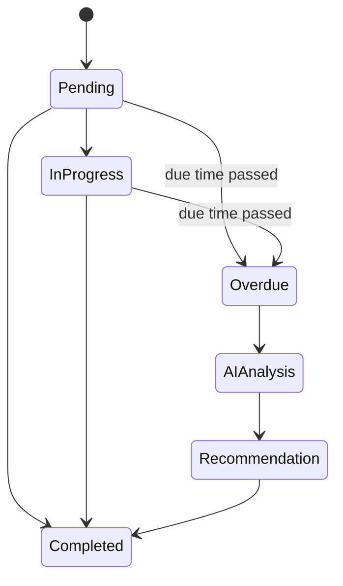
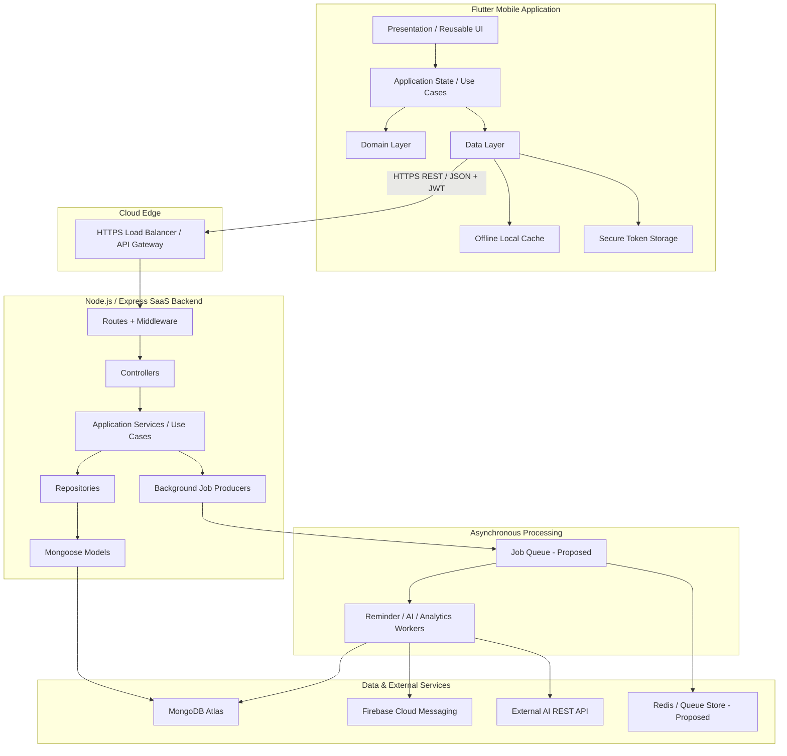
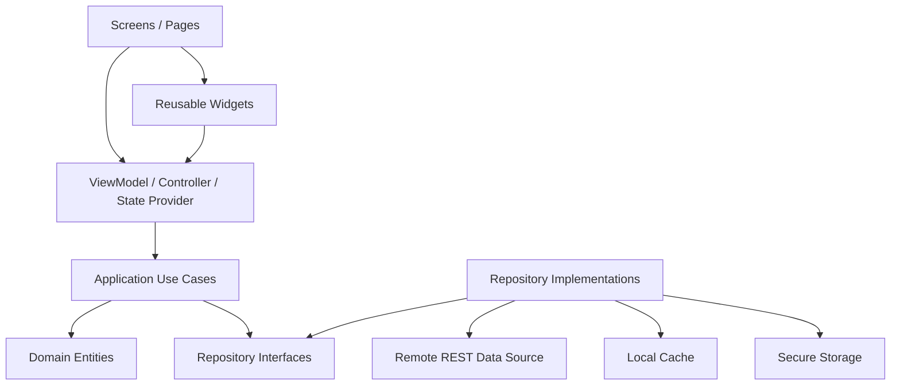
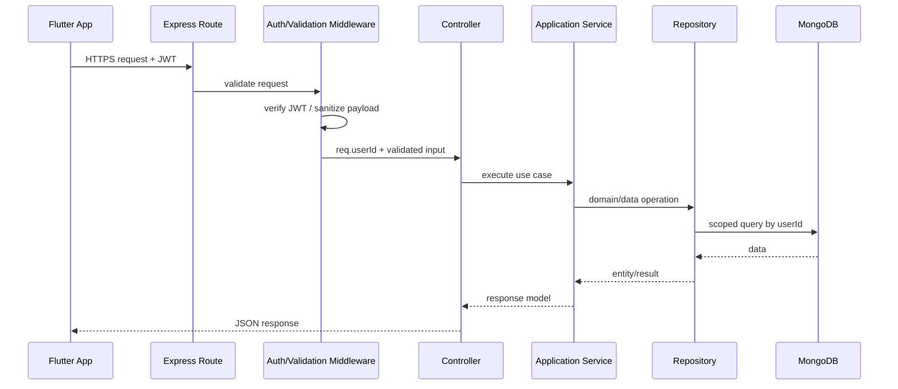
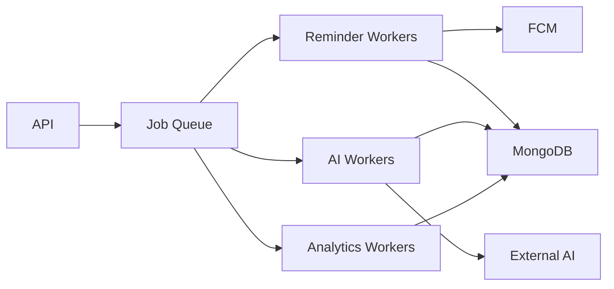
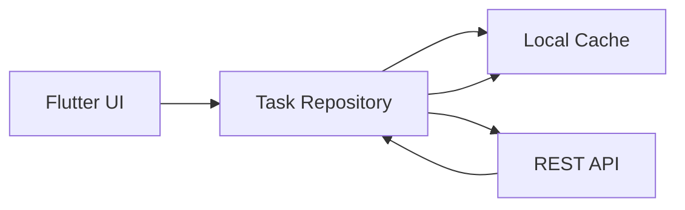
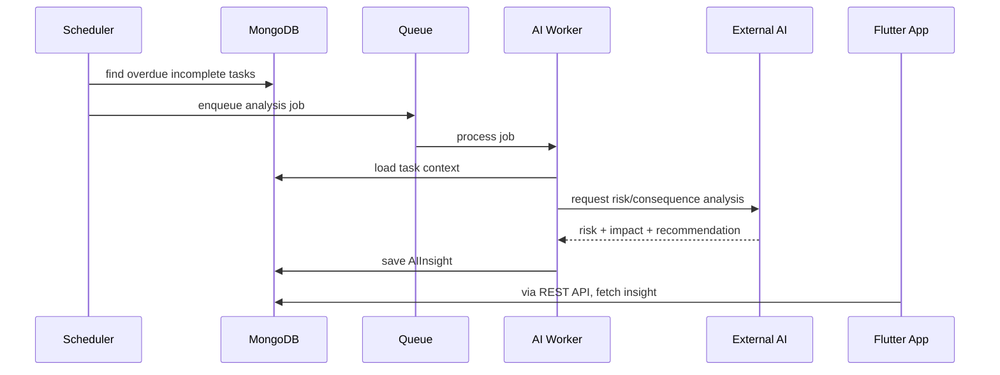
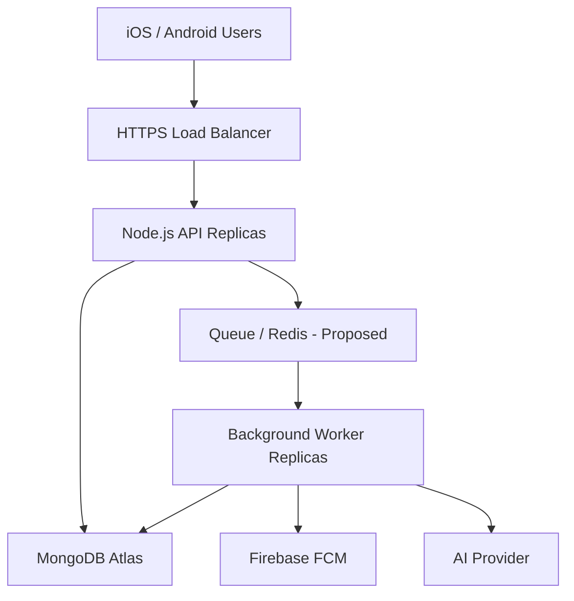

# URUS 2026 — Project Summary & Scalable System Architecture

**Project:** URUS 2026 Personal Productivity and Task Management Mobile Application  
**Organization:** MYSZ Technology  
**Document purpose:** Consolidated project summary plus a proposed clean, layered, SaaS-ready implementation architecture derived from the URUS SRS and SDD.

> **Source baseline:** This document is grounded in the provided Software Requirements Specification (SRS) and Software Design Document (SDD).  
> **Architecture extensions:** Items marked **Proposed** are implementation decisions added to satisfy the requested goals of clean structure, multiple layers, SaaS deployment, scalability, maintainability, and reusable Flutter UI. They are not stated verbatim in the source documents.

---

## 1. Executive Summary

URUS 2026 is a cross-platform personal productivity and task-management application for Android and iOS. Its purpose is to help an individual user organize tasks, schedule due dates and reminders, receive notifications, review productivity analytics, and receive AI-generated risk/consequence insights for overdue or high-priority tasks.

The source documents define a cloud-connected architecture using:

- **Flutter / Dart** for the mobile client.
- **Node.js + Express.js** for the REST API.
- **MongoDB Atlas + Mongoose** for persistence.
- **JWT** for stateless API authentication.
- **bcrypt / bcryptjs** for password hashing.
- **Firebase Cloud Messaging (FCM)** for push notifications.
- **External AI REST API / AI microservice** for task risk analysis and intelligent assistance.
- **REST + JSON over HTTPS** for client/server communication.
- **Git / GitHub** for version control.

The recommended target implementation in this document keeps that technology baseline while improving the internal organization into explicit layers and independently maintainable modules.

---

## 2. Product Objective

URUS is intended to provide one place for a user to:

1. Register and authenticate securely.
2. Create, view, update, delete, filter, and complete tasks.
3. Classify tasks by category and priority.
4. Schedule due dates, due times, and reminders.
5. Receive local and/or FCM notifications.
6. View tasks on a calendar.
7. Monitor completion statistics, task counts, streaks, and trends.
8. Automatically detect overdue tasks.
9. Run AI risk/consequence analysis on overdue or high-priority tasks.
10. Present actionable AI recommendations to help the user reprioritize work.

---

## 3. Scope

### 3.1 MVP Scope

The SRS defines the MVP target as including:

- User registration.
- JWT authentication.
- Task CRUD.
- Category management.
- Priority levels.
- Date/time scheduling.
- Local/FCM notification engine.
- Analytics dashboard.
- Core AI consequence analysis.

### 3.2 Post-MVP Scope

The source defines the following as post-MVP:

- Repeat-task engine.
- Expanded conversational AI workflows.
- Trend reporting.
- Advanced profile configuration.

### 3.3 Out of Scope in the Source Documents

The SRS explicitly excludes:

- Enterprise multi-tenant team management.
- Shared task collaboration.
- Gamification.
- Wearable hardware integration.

### 3.4 SaaS Interpretation for This Architecture

**Proposed:** URUS should be deployed as a **cloud-hosted SaaS application for individual users**, but the MVP should **not** implement organization/team tenancy or collaborative workspaces.

Each authenticated user is isolated through `userId`. This is consistent with the source requirement that database queries must be scoped using the authenticated user's ID.

The architecture should be designed so a future `workspaceId` or `tenantId` can be introduced later without rewriting the whole system, but that capability is **not part of the MVP**.

---

## 4. User Classes

### End User

A mobile user who wants to:

- Organize personal or work tasks.
- Receive time-sensitive reminders.
- Monitor productivity.
- Receive AI-based task risk insights.

### Automated System Services

Background processes that:

- Detect reminder trigger times.
- Dispatch notifications.
- Detect overdue tasks.
- Trigger AI analysis.
- Compile analytics.

---

## 5. Core Functional Modules

The SRS groups the system into five main functional areas.

### 5.1 Authentication & Profile

Required behavior:

- Register with name, email, and password.
- Validate email syntax.
- Reject duplicate email registrations.
- Authenticate against hashed passwords.
- Return a signed JWT after successful login.
- View/edit user profile.
- Toggle notification preferences.

### 5.2 Task & Note Lifecycle

A task contains, at minimum:

- Title.
- Optional description.
- Category.
- Priority.
- Status.
- Due date.
- Due time.
- Completion timestamp.
- User ownership reference.

Categories initially include:

- Study.
- Work.
- Personal.

Priorities:

- Low.
- Medium.
- High.
- Urgent.

Statuses:

- Pending.
- In Progress.
- Overdue.
- Completed.

Required operations:

- Create task.
- Query/filter task list.
- Modify task.
- Delete task.
- Mark task as completed.
- Filter by status, date, category, and priority.

### 5.3 Reminders & Push Notifications

Required behavior:

- Configure reminder offset in minutes before task due time.
- Calculate actual reminder trigger timestamp.
- Dispatch a local or FCM push notification when the trigger time is reached.
- Store task/reminder relationships and delivery flags.

### 5.4 Calendar & Analytics

Required behavior:

- Monthly calendar view.
- Daily task mapping.
- Total task count.
- Pending task count.
- Overdue task count.
- Completed task count.
- Active streak.
- Completion percentage.
- Weekly/monthly analytics.

Completion rate:

```text
Completion Rate (%) = (Completed Tasks / Total Tasks) × 100
```

### 5.5 AI Intelligent Assistance

Required behavior:

- Evaluate overdue or high-priority tasks.
- Assign risk classification:
  - Low
  - Medium
  - High
- Generate structured consequence/impact notes.
- Generate actionable recommendations.
- Surface insights on the dashboard and task-related views.
- Support natural-language-to-task parsing as defined in the SRS.

---

## 6. Task Lifecycle

The source defines the main task lifecycle as:



Conceptually:

1. A new task begins as `Pending`.
2. The user may start work and move it to `In Progress`.
3. The user may mark it `Completed`.
4. If current time passes the task due time and the task is not complete, it becomes `Overdue`.
5. Overdue/high-priority tasks can trigger AI analysis.
6. AI produces risk, consequence notes, and recommended actions.

---

## 7. Screen Blueprint

There is a difference between the SDD and SRS screen lists.

### SDD Screen Set

The SDD lists:

1. Splash
2. Login
3. Register
4. Home Dashboard
5. Task List
6. Create Task
7. Edit Task
8. Calendar
9. AI Insight
10. Analytics
11. Profile
12. Settings

### SRS Screen Set

The SRS lists:

1. Splash
2. Login
3. Register
4. Dashboard
5. Create / Edit Task
6. Task Details
7. Calendar
8. Analytics
9. AI Consequence Analysis
10. Notification List
11. Profile Settings
12. Search & Filter

### Proposed Implementation Resolution

For implementation, use the **SRS list as the formal requirement baseline**, while preserving useful SDD concepts as routes, modes, or child views.

Recommended route model:

```text
/splash
/auth/login
/auth/register

/home
/tasks
/tasks/create
/tasks/:id
/tasks/:id/edit
/tasks/search

/calendar
/analytics
/insights/:taskId
/notifications
/profile
/settings
```

This keeps the required experience without forcing every logical mode to become a completely separate visual page.

---

# 8. Target System Architecture

## 8.1 Architecture Principles

The target architecture should satisfy these goals:

- Clean project structure.
- Clear separation of concerns.
- Multiple explicit layers.
- SaaS/cloud deployment.
- High scalability.
- High maintainability.
- Reusable UI/widgets.
- Testable modules.
- Replaceable external integrations.
- Offline-capable mobile client.
- Stateless backend wherever possible.
- Async processing for slow/background work.
- Strong user-data isolation.

---

## 8.2 High-Level Architecture



---

## 8.3 Why This Architecture

The source SDD defines a decoupled three-tier system:

1. Flutter client.
2. Node.js/Express application server.
3. MongoDB + external AI/notification services.

The proposed architecture **retains those three deployment tiers** but adds internal layers inside each tier.

This avoids turning the MVP into many independent microservices too early while still creating boundaries that allow later extraction.

### Recommended pattern

**Modular Monolith + Background Workers**

Use one primary backend application for MVP, separated into modules/layers internally.

Advantages:

- Simpler deployment than full microservices.
- Easier local development.
- Easier transaction/data consistency.
- Lower operational complexity.
- Still horizontally scalable because the API remains stateless.
- AI/reminder/analytics workers can scale independently.
- Modules can become microservices later if actual load requires it.

---

# 9. Flutter Client Architecture

## 9.1 Client Layering



### Layer responsibilities

#### Presentation Layer

Contains:

- Screens/pages.
- Feature-specific widgets.
- Reusable design-system widgets.
- UI state rendering.
- Navigation interaction.

Must **not** contain REST calls or MongoDB/API-specific logic.

#### Application Layer

Contains:

- State controllers/providers.
- Use-case coordination.
- Form submission flows.
- Screen-level orchestration.
- Validation flow coordination.

#### Domain Layer

Contains:

- Core entities.
- Repository contracts.
- Business rules.
- Value objects/enums.

Should be mostly framework-independent Dart.

#### Data Layer

Contains:

- REST API client.
- DTOs.
- JSON serialization.
- Repository implementations.
- Offline cache.
- Secure token storage.
- Network/offline synchronization.

---

## 9.2 Proposed Flutter Directory Structure

```text
lib/
├── main.dart
│
├── app/
│   ├── app.dart
│   ├── bootstrap.dart
│   ├── router/
│   │   ├── app_router.dart
│   │   └── route_names.dart
│   ├── theme/
│   │   ├── app_theme.dart
│   │   └── theme_controller.dart
│   └── di/
│       └── providers.dart
│
├── core/
│   ├── constants/
│   ├── errors/
│   ├── network/
│   │   ├── api_client.dart
│   │   ├── api_endpoints.dart
│   │   └── auth_interceptor.dart
│   ├── storage/
│   │   ├── secure_storage.dart
│   │   └── local_database.dart
│   ├── utils/
│   ├── validators/
│   └── extensions/
│
├── design_system/
│   ├── tokens/
│   │   ├── app_colors.dart
│   │   ├── app_spacing.dart
│   │   ├── app_radius.dart
│   │   ├── app_typography.dart
│   │   └── app_icons.dart
│   ├── components/
│   │   ├── app_button.dart
│   │   ├── app_text_field.dart
│   │   ├── app_card.dart
│   │   ├── app_scaffold.dart
│   │   ├── app_bottom_nav.dart
│   │   ├── status_chip.dart
│   │   ├── priority_badge.dart
│   │   ├── category_badge.dart
│   │   ├── loading_view.dart
│   │   ├── empty_state.dart
│   │   └── error_view.dart
│   └── theme/
│
├── features/
│   ├── auth/
│   │   ├── presentation/
│   │   ├── application/
│   │   ├── domain/
│   │   └── data/
│   │
│   ├── dashboard/
│   │   ├── presentation/
│   │   ├── application/
│   │   ├── domain/
│   │   └── data/
│   │
│   ├── tasks/
│   │   ├── presentation/
│   │   │   ├── screens/
│   │   │   └── widgets/
│   │   ├── application/
│   │   ├── domain/
│   │   └── data/
│   │
│   ├── calendar/
│   ├── analytics/
│   ├── insights/
│   ├── notifications/
│   └── profile/
│
└── shared/
    ├── domain/
    └── application/
```

---

## 9.3 Reusable UI Strategy

The UI should not duplicate buttons, cards, colors, spacing, badges, or form elements inside individual screens.

### Global reusable design-system components

Examples:

- `AppButton`
- `AppTextField`
- `AppCard`
- `AppScaffold`
- `AppBottomNav`
- `StatusChip`
- `PriorityBadge`
- `CategoryBadge`
- `LoadingView`
- `ErrorView`
- `EmptyState`
- `ConfirmationDialog`
- `DateTimeField`

### Feature-level reusable components

Examples:

```text
features/tasks/presentation/widgets/
├── task_card.dart
├── task_list.dart
├── task_form.dart
├── task_filter_bar.dart
├── task_due_date.dart
└── task_status_action.dart
```

```text
features/dashboard/presentation/widgets/
├── greeting_header.dart
├── ai_insight_card.dart
├── quick_stats.dart
└── today_task_section.dart
```

Rule:

> If a component is usable across multiple features, place it in `design_system/components`.  
> If it only makes sense inside one business feature, keep it inside that feature.

---

## 9.4 Design Tokens Required by the SRS

Typography:

```text
Poppins
```

Primary brand color:

```text
URUS Green: #84CC16
```

Status colors:

```text
Urgent Red:      #EF4444
Warning Amber:   #F59E0B
Completed Green: #22C55E
AI Purple:       #8B5CF6
```

All screens should consume centralized tokens instead of hard-coded values.

---

# 10. Backend Architecture

## 10.1 Request Flow



---

## 10.2 Backend Layers

### Routes

Responsibilities:

- Declare REST endpoints.
- Attach middleware.
- Map HTTP method to controller.
- No business logic.

### Middleware

Responsibilities:

- JWT authentication.
- Input sanitization.
- Payload validation.
- Request IDs/logging.
- Error handling.
- **Proposed:** rate limiting.

### Controllers

Responsibilities:

- Read validated request data.
- Call application service.
- Return HTTP response.
- Map application errors to HTTP errors.

Controllers should remain thin.

### Services / Application Layer

Responsibilities:

- Execute use cases.
- Apply business workflow.
- Coordinate repositories.
- Trigger background jobs.
- Call integration adapters through interfaces.

Examples:

- `registerUser`
- `loginUser`
- `createTask`
- `updateTask`
- `completeTask`
- `scheduleReminder`
- `analyseTask`
- `getDashboardAnalytics`

### Repositories

**Proposed addition for maintainability.**

Responsibilities:

- Hide Mongoose queries from services.
- Enforce standard query patterns.
- Centralize user ownership scoping.
- Make services unit-testable without MongoDB.

### Models

Mongoose schemas for:

- User.
- Task.
- Reminder.
- Category.
- AIInsight.

### Integration Services

Adapters for:

- FCM.
- External AI.
- Queue.
- Other future external systems.

### Background Workers

Long-running or delayed operations should be separated from API request execution.

Candidates:

- Reminder dispatch.
- Overdue task scanner.
- AI risk processing.
- Analytics aggregation.

---

## 10.3 Proposed Backend Directory Structure

```text
backend/
├── src/
│   ├── app.js
│   ├── server.js
│   │
│   ├── config/
│   │   ├── env.js
│   │   ├── database.js
│   │   ├── logger.js
│   │   └── constants.js
│   │
│   ├── routes/
│   │   ├── index.js
│   │   ├── auth.routes.js
│   │   ├── task.routes.js
│   │   ├── reminder.routes.js
│   │   ├── ai.routes.js
│   │   └── analytics.routes.js
│   │
│   ├── controllers/
│   │   ├── auth.controller.js
│   │   ├── task.controller.js
│   │   ├── reminder.controller.js
│   │   ├── ai.controller.js
│   │   └── analytics.controller.js
│   │
│   ├── middleware/
│   │   ├── auth.middleware.js
│   │   ├── validate.middleware.js
│   │   ├── error.middleware.js
│   │   ├── not_found.middleware.js
│   │   └── rate_limit.middleware.js
│   │
│   ├── services/
│   │   ├── auth.service.js
│   │   ├── task.service.js
│   │   ├── reminder.service.js
│   │   ├── ai.service.js
│   │   └── analytics.service.js
│   │
│   ├── repositories/
│   │   ├── user.repository.js
│   │   ├── task.repository.js
│   │   ├── reminder.repository.js
│   │   ├── category.repository.js
│   │   └── ai_insight.repository.js
│   │
│   ├── models/
│   │   ├── User.js
│   │   ├── Task.js
│   │   ├── Reminder.js
│   │   ├── Category.js
│   │   └── AIInsight.js
│   │
│   ├── validators/
│   │   ├── auth.validator.js
│   │   ├── task.validator.js
│   │   └── reminder.validator.js
│   │
│   ├── integrations/
│   │   ├── fcm/
│   │   │   └── fcm.client.js
│   │   └── ai/
│   │       └── ai.client.js
│   │
│   ├── jobs/
│   │   ├── queue.js
│   │   ├── reminder.producer.js
│   │   ├── ai.producer.js
│   │   └── analytics.producer.js
│   │
│   ├── workers/
│   │   ├── reminder.worker.js
│   │   ├── overdue.worker.js
│   │   ├── ai.worker.js
│   │   └── analytics.worker.js
│   │
│   └── utils/
│       ├── async_handler.js
│       ├── api_response.js
│       └── app_error.js
│
├── tests/
│   ├── unit/
│   ├── integration/
│   └── contract/
│
├── .env.example
├── package.json
└── README.md
```

This retains the source-required MVC folders (`controllers`, `models`, `routes`, `middleware`, `services`) while adding repositories, integrations, jobs, and workers to keep the codebase maintainable as it grows.

---

# 11. Data Model Summary

## 11.1 User

Source-supported fields:

```text
id
name
email
passwordHash
fcmToken
notificationPreferences
createdAt
updatedAt
```

Security rule:

- Never store plaintext passwords.
- Hash passwords using bcrypt/bcryptjs with salt factor >= 10.

---

## 11.2 Task

```text
id
userId
title
description
category
priority
status
dueDate
dueTime
completedAt
createdAt
updatedAt
```

Recommended indexes:

```text
{ userId, status }
{ userId, dueDate }
{ userId, category }
{ userId, priority }
{ userId, dueDate, status }
```

The index recommendations are **Proposed** scalability optimizations.

---

## 11.3 Reminder

```text
id
userId
taskId
triggerAt
leadTimeMinutes
delivered
createdAt
updatedAt
```

---

## 11.4 Category

```text
id
userId?           // null/system-owned for defaults
name
hexColor
icon
isSystemDefault
```

---

## 11.5 AIInsight

```text
id
userId
taskId
riskLevel
impactNotes
recommendation
createdAt
updatedAt
```

---

# 12. REST API

The SDD says routes are declared under `/api/v1`, while its endpoint examples are written with `/api/...`.

**Proposed canonical convention:** use `/api/v1` consistently.

## Authentication

```http
POST   /api/v1/auth/register
POST   /api/v1/auth/login
POST   /api/v1/auth/logout
GET    /api/v1/auth/profile
```

## Tasks

```http
GET    /api/v1/tasks
GET    /api/v1/tasks/:id
POST   /api/v1/tasks
PUT    /api/v1/tasks/:id
DELETE /api/v1/tasks/:id
PATCH  /api/v1/tasks/:id/complete
```

Example filtering:

```http
GET /api/v1/tasks?status=Pending&category=Work&priority=High&date=2026-10-05
```

## Reminders

```http
GET    /api/v1/reminders
POST   /api/v1/reminders
PUT    /api/v1/reminders/:id
DELETE /api/v1/reminders/:id
```

## AI

```http
POST   /api/v1/ai/analyse-task
GET    /api/v1/ai/insights
GET    /api/v1/ai/insights/:taskId
```

## Analytics

```http
GET    /api/v1/analytics/dashboard
GET    /api/v1/analytics/weekly
GET    /api/v1/analytics/monthly
```

---

# 13. SaaS Scalability Strategy

## 13.1 Stateless API Instances

JWT-based authentication allows normal REST API instances to remain stateless.

**Proposed deployment:**

```text
                    ┌─────────────────┐
Flutter Apps ──────>│ Load Balancer   │
                    └───────┬─────────┘
                            │
               ┌────────────┼────────────┐
               ▼            ▼            ▼
          API Instance  API Instance  API Instance
               │            │            │
               └────────────┼────────────┘
                            ▼
                      MongoDB Atlas
```

More API instances can be added as traffic increases.

---

## 13.2 Asynchronous Work

AI calls and notification scheduling should not block normal user requests unnecessarily.

**Proposed:**



A Redis-backed queue such as BullMQ is a possible implementation, but the source documents do not mandate a queue technology.

---

## 13.3 Database Scaling

Start with MongoDB Atlas using proper indexes.

Scale progressively:

1. Correct compound indexes.
2. Query optimization.
3. Replica-set capacity increase.
4. Read scaling where appropriate.
5. Sharding only if real data volume requires it.

Do not introduce sharding during MVP unless actual usage requires it.

---

## 13.4 Independent Worker Scaling

Examples:

- Notification traffic rises -> increase reminder workers.
- AI traffic rises -> increase AI workers.
- API traffic rises -> increase API replicas.

This is more efficient than scaling the entire system as one process.

---

# 14. Offline Resilience

The SRS requires existing tasks to remain viewable during network drops and changes to synchronize after reconnection.

Recommended mobile data flow:



Principles:

- UI reads through a repository, not directly from HTTP.
- Repository can return cached task data.
- Network refresh updates the local cache.
- Offline mutations can be queued for later synchronization.

The exact conflict-resolution rule is not defined in the provided SRS/SDD and should be finalized before production synchronization logic is implemented.

---

# 15. Security Architecture

The architecture must preserve the source requirements.

## Authentication

- JWT-based stateless authentication.
- JWT has expiration.
- Protected endpoints require:

```http
Authorization: Bearer <JWT_TOKEN>
```

## Passwords

- bcrypt/bcryptjs.
- Minimum salt factor: 10.
- Never return password hashes through API responses.

## User Data Isolation

Every user-owned query must include authenticated user ownership.

Example:

```js
{
  _id: taskId,
  userId: req.userId
}
```

Never query a task by `_id` alone on a protected user route.

## Input Validation

Validate and sanitize:

- Registration input.
- Login input.
- Task fields.
- Categories.
- Priority.
- Status.
- Dates.
- Reminder offsets.
- Query filters.

## Secret Management

Environment secrets include items such as:

```text
MONGO_URI
JWT_SECRET
FCM_KEY
AI_API_KEY
```

Do not commit secrets to Git.

## Error Handling

Use centralized exception middleware.

Production responses must not expose:

- Stack traces.
- Internal connection strings.
- Database details.
- API credentials.

## Additional Proposed SaaS Protections

For production scaling:

- Rate limiting.
- Structured audit/security logging.
- HTTPS-only traffic.
- CORS restrictions where applicable.
- Request size limits.
- Dependency vulnerability scanning.
- Key rotation procedures.

---

# 16. Performance & Reliability

The SRS requires core REST endpoints such as Task CRUD and Analytics Dashboard to respond within:

```text
< 1.5 seconds under standard operating conditions
```

Recommended practices:

- Index common MongoDB filters.
- Do not call AI synchronously on unrelated task-list APIs.
- Paginate large task lists.
- Project only required MongoDB fields.
- Run expensive analytics asynchronously or cache aggregates where justified.
- Use request timeouts for external AI/FCM calls.
- Apply retry policies to background jobs, not blindly to every API request.
- Add health checks for API and workers.

---

# 17. Dashboard Architecture

The SDD defines the dashboard as the central control hub.

Required dashboard components:

- Personalized greeting.
- AI Insight card.
- Today's task list.
- Priority badges.
- Status indicators.
- Floating quick-add action.
- Persistent bottom navigation.

Recommended bottom navigation based on the SDD:

```text
Today | Tasks | + | Calendar | Reports
```

Suggested widget structure:

```text
DashboardScreen
├── GreetingHeader
├── QuickStatsRow
├── AIInsightCard
├── TodayTaskSection
│   └── TaskCard[]
├── QuickAddFAB
└── AppBottomNav
```

---

# 18. AI Consequence Processing

Source behavior:

1. Check task due date/time.
2. Determine task status.
3. If overdue, evaluate priority and context.
4. Generate consequences.
5. Generate AI insight.
6. Present an action recommendation.

Recommended async implementation:



---

# 19. Maintainability Rules

## Backend

- Controllers stay thin.
- Services own use-case orchestration.
- Repositories own database access.
- External APIs are wrapped in adapters.
- No FCM calls directly from controllers.
- No Mongoose queries inside routes.
- No JWT parsing scattered across services.
- No duplicate validation logic.
- Shared error/response utilities are centralized.

## Flutter

- Screens do not call HTTP directly.
- Widgets do not parse JSON.
- Domain entities do not depend on UI widgets.
- Reusable visual tokens are centralized.
- Feature-specific widgets remain inside their feature.
- Global reusable controls live in the design system.
- API DTOs stay in the data layer.
- Business logic is not embedded in `build()` methods.

---

# 20. Testing Strategy

## Flutter

### Unit tests

- Task filtering.
- Completion state.
- Analytics calculation.
- Form validation.
- Repository behavior.
- State/controller logic.

### Widget tests

- Task cards.
- Priority badges.
- Status chips.
- Task forms.
- Dashboard insight card.
- Empty/error/loading states.

### Integration tests

- Register -> login -> dashboard.
- Create -> edit -> complete task.
- Search/filter.
- Calendar mapping.
- Offline cached task view.

## Backend

### Unit tests

- Authentication service.
- Task service.
- Reminder time calculation.
- Analytics calculation.
- AI service mapping.

### Integration tests

- Auth routes.
- Task CRUD routes.
- User data isolation.
- Reminder endpoints.
- Analytics endpoints.

### Security tests

A user must never be able to:

- Fetch another user's task.
- Edit another user's task.
- Delete another user's task.
- Read another user's reminder or insight.

### Performance tests

Validate the source requirement that core endpoints remain below 1.5 seconds under defined standard operating conditions.

---

# 21. Observability — Proposed

For a scalable SaaS deployment, introduce:

- Structured JSON logs.
- Request ID/correlation ID.
- API latency metrics.
- HTTP error metrics.
- Worker job success/failure metrics.
- AI provider latency/failure metrics.
- FCM delivery attempt metrics.
- Database query monitoring.
- Alerts for repeated failures.

Important events:

```text
USER_REGISTERED
USER_LOGIN_SUCCESS
USER_LOGIN_FAILED

TASK_CREATED
TASK_UPDATED
TASK_COMPLETED
TASK_BECAME_OVERDUE
TASK_DELETED

REMINDER_SCHEDULED
REMINDER_SENT
REMINDER_FAILED

AI_ANALYSIS_QUEUED
AI_ANALYSIS_COMPLETED
AI_ANALYSIS_FAILED
```

Do not log passwords, JWT values, or sensitive secrets.

---

# 22. Environment & Deployment Strategy — Proposed

Use separate environments:

```text
development
staging
production
```

Recommended deployment units:

```text
urus-mobile
urus-api
urus-worker-reminder
urus-worker-ai
urus-worker-analytics
```

External managed services:

```text
MongoDB Atlas
Firebase Cloud Messaging
External AI API
Optional Redis / managed queue
```

Typical production flow:



---

# 23. CI/CD — Proposed

Recommended Git workflow:

```text
feature/* -> pull request -> main
```

Pipeline checks:

1. Install dependencies.
2. Lint.
3. Static analysis.
4. Unit tests.
5. Integration tests.
6. Build.
7. Security/dependency scan.
8. Deploy staging.
9. Run smoke tests.
10. Production deployment after approval.

Flutter and backend pipelines can run independently.

---

# 24. Architecture Dependency Rules

## Flutter

Allowed dependency direction:

```text
Presentation
    ↓
Application
    ↓
Domain
    ↑
Data / Infrastructure
```

The domain should not depend on Flutter UI or HTTP libraries.

## Backend

Allowed dependency direction:

```text
Routes
  ↓
Middleware
  ↓
Controllers
  ↓
Services / Use Cases
  ↓
Repositories
  ↓
Models / Database
```

External systems should be reached through integration adapters rather than directly from controllers.

---

# 25. Recommended Development Order

## Phase 1 — Foundation

- Flutter app shell.
- Theme/design tokens.
- Routing.
- API client.
- Secure storage.
- Backend server.
- MongoDB connection.
- Global errors and validation.

## Phase 2 — Authentication

- Register.
- Login.
- JWT.
- Profile fetch.
- Auth guard.

## Phase 3 — Task Core

- Task entity/model.
- CRUD APIs.
- Task list.
- Create/edit task form.
- Task detail.
- Completion state.
- Filters.

## Phase 4 — Calendar & Offline Cache

- Calendar mapping.
- Local task cache.
- Network refresh.
- Offline read support.

## Phase 5 — Reminder System

- Reminder model.
- Scheduling logic.
- Worker.
- FCM integration.
- Notification list.

## Phase 6 — Analytics

- Dashboard counters.
- Completion rate.
- Streak.
- Weekly/monthly analytics.

## Phase 7 — AI

- Overdue scanner.
- AI job.
- AI provider adapter.
- AIInsight persistence.
- Insight UI.

## Phase 8 — Production Hardening

- Rate limiting.
- Structured logging.
- Monitoring.
- Performance tests.
- Security tests.
- Worker retries.
- Deployment automation.

---

# 26. Architectural Decisions Summary

| Concern | Decision |
|---|---|
| Mobile | Flutter / Dart |
| API | Node.js + Express |
| Database | MongoDB Atlas + Mongoose |
| API style | REST JSON over HTTPS |
| Authentication | JWT |
| Password security | bcrypt/bcryptjs, salt >= 10 |
| Notifications | Firebase Cloud Messaging |
| AI | External AI REST service |
| Backend structure | Layered MVC + repositories + integration adapters |
| Deployment model | SaaS cloud deployment for individual users |
| MVP tenancy | User-level isolation with `userId`; no team tenancy |
| Scalability | Stateless API replicas + independently scalable workers |
| Background work | Queue/worker architecture — proposed |
| Mobile architecture | Feature-first + presentation/application/domain/data layers |
| Offline requirement | Local cache + repository synchronization |
| UI reuse | Central design system + feature widgets |
| Branding | Poppins, #84CC16 and required status colors |
| Performance | Core APIs < 1.5 s under standard conditions |
| Testing | Unit + widget + integration + security + performance |

---

# 27. Non-Negotiable Engineering Rules

1. Every protected data query must be scoped to the authenticated user.
2. Passwords must never be stored in plaintext.
3. UI screens must not directly contain networking/database logic.
4. Backend routes/controllers must not become business-logic containers.
5. External AI/FCM integrations must be isolated behind service adapters.
6. Reusable UI must use centralized design tokens/components.
7. Core API operations must target the SRS response-time requirement.
8. Existing tasks must remain viewable when the mobile device temporarily loses network connectivity.
9. Slow/background operations should not reduce API responsiveness.
10. The MVP should not implement enterprise team collaboration or organization-level tenancy unless the product scope is formally changed.

---

# 28. Final Recommended Architecture

For URUS 2026, the most appropriate architecture is:

> **A layered Flutter mobile client + a modular, stateless Node.js/Express backend + MongoDB Atlas + asynchronous workers for reminders/AI/analytics + FCM + an external AI provider.**

This architecture remains aligned with the SRS/SDD technology choices while making the project easier to maintain and scale.

The key design choice is **not** to start with a large microservice ecosystem. Instead, use a clean modular backend with strong layer boundaries and extract high-load workloads such as reminders and AI processing into workers. This gives URUS a practical MVP architecture while preserving a clear path to a larger SaaS platform later.

---

# 29. Source Traceability

This summary was prepared from the provided:

- **Software Requirements Specification (SRS) — URUS 2026**
  - Purpose and scope.
  - MVP/post-MVP/out-of-scope definitions.
  - User classes.
  - Functional requirements.
  - Task lifecycle.
  - Security requirements.
  - Performance/reliability requirements.
  - UI/UX design tokens.
  - 12-screen target blueprint.

- **Software Design Document (SDD) — URUS 2026**
  - Three-tier system architecture.
  - Node.js/Express MVC structure.
  - Controllers/models/routes/middleware/services.
  - Dashboard/navigation design.
  - AI consequence flow.
  - Security architecture.
  - REST endpoints.
  - Technology stack.

## Proposed items not explicitly mandated by the source documents

The following are architecture recommendations added to meet the requested scalability/maintainability goals:

- Repository layer.
- API gateway/load balancer deployment.
- Redis/job queue.
- Independent background worker deployment.
- Rate limiting.
- Structured observability.
- CI/CD structure.
- MongoDB index recommendations.
- Feature-first Flutter directory organization.
- Explicit Flutter clean-architecture layers.
- Consistent `/api/v1` endpoint prefix.
- Future-ready tenancy boundary without implementing team tenancy in MVP.

These additions should be treated as implementation architecture decisions rather than original SRS/SDD requirements.
